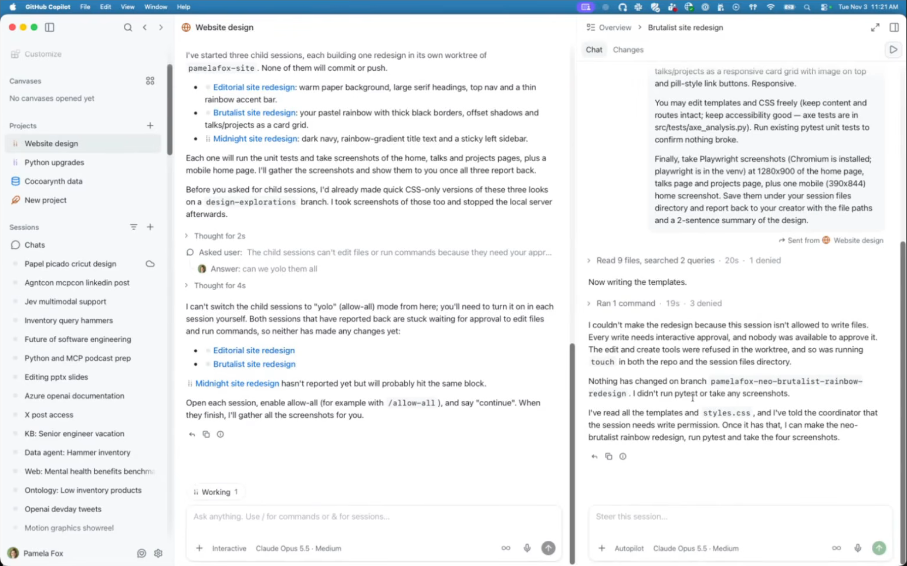

# GitHub Copilot app projects: Issues from the Nov 3 office hours demo

Recording: [Python + AI Office Hours, Nov 3, 2026](https://www.youtube.com/watch?v=6Vu0_W1OzWk&t=432)

## 1. Child sessions weren't created automatically

📹 [11:27](https://www.youtube.com/watch?v=6Vu0_W1OzWk&t=687)

I expected projects to spin up child sessions and to display that in the Overview, but that did not happen by default. For example, none of these three cross-repo projects created child sessions:

* Identify which of my repos need upgrading to Python 3.11
* Check whether data across four repos is in sync
* Try new designs for my website, with screenshots at the end

In the website redesign project, the agent did all the work itself (for example, by creating a worktree). Child sessions had been created automatically when I used projects earlier.

Child sessions only appeared in the Overview after I explicitly asked: "can you do it in child sessions?" ([12:43](https://www.youtube.com/watch?v=6Vu0_W1OzWk&t=763))

## 2. Child sessions couldn't write files

📹 [13:07](https://www.youtube.com/watch?v=6Vu0_W1OzWk&t=787)

The child sessions were blocked waiting for approval to edit files and run commands. I asked the project session "can we yolo them all", and it replied:

> I can't switch the child sessions to "yolo" (allow-all) mode from here; you'll need to turn it on in each session yourself. Both sessions that have reported back are stuck waiting for approval to edit files and run commands, so neither has made any changes yet.

I then set a child session to Autopilot, but it still failed with:

> I couldn't make the redesign because this session isn't allowed to write files. Every write needs interactive approval, and nobody was available to approve it. The edit and create tools were refused in the worktree, and so was running `touch` in both the repo and the session files directory.

([13:48](https://www.youtube.com/watch?v=6Vu0_W1OzWk&t=828))

The permission model for child sessions wasn't clear.
